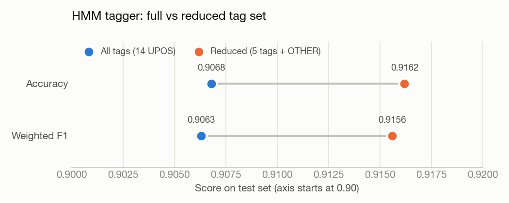
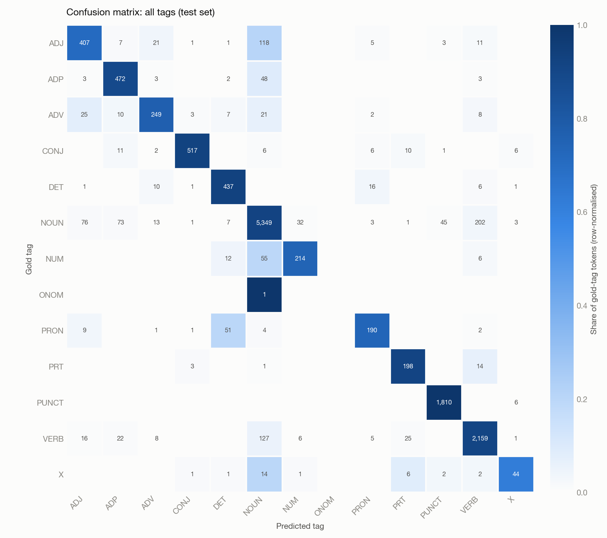
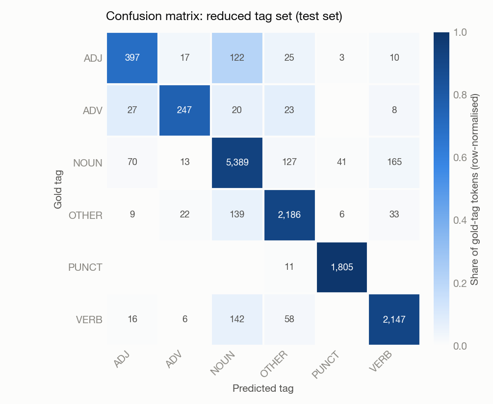

# Turkish HMM POS Tagger

A hidden Markov model part-of-speech tagger for Turkish, built from scratch with maximum-likelihood estimation and Viterbi decoding.

## Highlights

- HMM written from scratch: MLE transition and emission estimates, `<START>` / `<END>` states, and log-space Viterbi decoding. No HMM or tagging library is used.
- **91.62% accuracy / 0.9156 weighted F1** with a reduced tag set, and **90.68% / 0.9063** with all 14 Universal POS tags, on 971 held-out sentences (13,284 tokens).
- Trained on 4,851 sentences from the Google Research Turkish Treebanks (web and Wikipedia text).
- Error analysis with confusion matrices shows that most remaining errors come from ambiguity between content words (NOUN, VERB, ADJ).

## Overview

Part-of-speech tagging assigns a grammatical category (noun, verb, adjective, ...) to every word in a sentence. This project models the task as a first-order HMM: tags are hidden states, words are observations, and the most likely tag sequence is found with the Viterbi algorithm. Two settings are compared:

- **A, all tags:** the full Universal POS (UPOS) inventory found in the data (14 tags).
- **B, reduced tags:** `ADJ`, `ADV`, `NOUN`, `VERB` and `PUNCT` are kept, and every other tag is mapped to `OTHER`.

## Dataset

[Google Research Turkish Treebanks](https://github.com/google-research-datasets/turkish-treebanks): `web.conllu` and `wiki.conllu`, in CoNLL-U format.

- Combined corpus: 4,851 sentences (2,541 web, 2,310 Wikipedia) and 66,462 tokens as loaded.
- Sentence-level 80/20 split with `random_state=42`: 3,880 training and 971 test sentences.
- Each token is represented by its lemma (CoNLL-U column 3) and UPOS tag (column 4). Sub-token segments without a lemma (`_`) are skipped.

The dataset is released under the Apache License 2.0 by its authors and is **not included** in this repository. If you use it, please cite: Kayadelen, T., Öztürel, A. & Bohnet, B. (2020). *A Gold Standard Dependency Treebank for Turkish.* LREC 2020.

## Approach

1. **Counting (MLE):** tag-to-tag transitions (including `<START>` → first tag and last tag → `<END>`), tag-to-word emissions and tag frequencies are counted on the training set.
   - `P(tag | prev_tag) = count(prev_tag → tag) / count(prev_tag)`
   - `P(word | tag) = count(tag, word) / count(tag)`
2. **Decoding (Viterbi):** dynamic programming over the tag lattice in log space, with backpointers for path recovery and an explicit `<END>` transition at termination.
3. **Unseen events:** unseen transitions get a log-probability floor of -1e9. Unseen word/tag pairs (unknown words) get a constant emission probability of 1e-6, so the transition model decides their tag.
4. **Evaluation:** token-level accuracy, weighted F1 and gold vs. predicted confusion matrices on the test set, using scikit-learn metrics.

## Results

| Setting | Tags | Accuracy | Weighted F1 |
|---|---|---|---|
| A: all tags | 14 UPOS | 0.9068 | 0.9063 |
| B: reduced tags | ADJ, ADV, NOUN, VERB, PUNCT + OTHER | **0.9162** | **0.9156** |

Figures are drawn from the confusion matrices and scores printed in the notebook.







## Key findings

- **A smaller tag set helps the HMM.** The reduced setting is about one percentage point more accurate (91.62% vs. 90.68%), mainly because similar function-word tags such as determiners and pronouns are grouped into `OTHER`. In setting A, 51 pronouns are tagged as determiners.
- **Content words are the hard part.** In both settings the largest errors are between nouns, verbs and adjectives. In setting A, 202 nouns are tagged as verbs and 118 adjectives as nouns. In Turkish, adjectives often function as nouns, which a model without deeper context struggles to separate.
- **Limitations:** the first-order Markov assumption only looks at the previous tag, and unknown words are handled with a single constant probability.
- **Next step:** Turkish is agglutinative, so suffix-based features for unknown words would likely reduce the noun/verb confusion significantly.

## Tech stack

Python 3, NumPy, pandas, scikit-learn (train/test split and metrics only), Jupyter.

## Project structure

```
turkish-hmm-pos-tagger/
├── turkish_hmm_pos_tagger.ipynb   # data loading, HMM training, Viterbi, evaluation, discussion
├── figures/                       # result figures used in this README
├── requirements.txt
└── README.md
```

## How to run

```bash
git clone https://github.com/efe-akpinar/turkish-hmm-pos-tagger.git
cd turkish-hmm-pos-tagger
pip install -r requirements.txt

# download the treebank files into the project root
curl -LO https://raw.githubusercontent.com/google-research-datasets/turkish-treebanks/master/data/web.conllu
curl -LO https://raw.githubusercontent.com/google-research-datasets/turkish-treebanks/master/data/wiki.conllu

jupyter notebook turkish_hmm_pos_tagger.ipynb
```

Run the cells in order. The final cell trains and evaluates both settings and prints the scores and confusion matrices.
